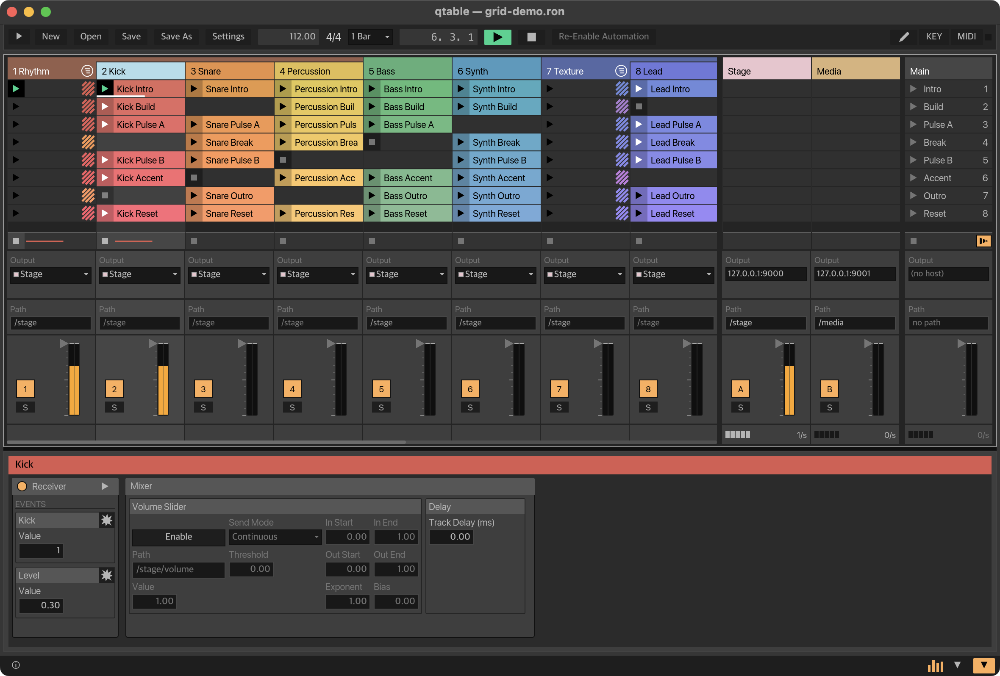

# qtable



qtable is a sequencer for [OSC](https://opensoundcontrol.stanford.edu/) (Open Sound Control), laid
out like the Session View of Ableton Live. Tracks run in columns, scenes in rows, and each slot can
hold a clip. Where a clip in Live holds notes or audio, a qtable clip holds timed OSC messages. You
launch clips and scenes in time with a tempo, and qtable sends their messages over UDP to whatever
listens: lighting, video, visuals, synths, a game engine, your own code.

It may suit you if you already drive something over OSC and want to play it like a live set
instead of scripting a fixed timeline. It makes no sound and sends no MIDI; MIDI comes in only to
control qtable itself.

## What it does

- **Clips as timelines.** A clip holds OSC events at positions in bars and beats, plus automation
  envelopes for values that change over time. It loops or plays once.
- **Launching, as in Live.** Clips and scenes start on a quantisation boundary (the next bar, by
  default). Follow actions chain clips and scenes, and group tracks launch a row of their members.
- **Outputs.** Each output names a receiver: host, port, unicast or broadcast UDP, and an address
  prefix. A track routes to one output or several.
- **Devices.** A track's Target device defines the messages its clips send: events and parameters,
  each with a path and typed arguments (Float, Int, Bool, String).
- **Timing.** A dedicated scheduler thread sends the messages, and each track has a delay in
  milliseconds for lining up a slow receiver.
- **Control.** MIDI Map Mode and Key Map Mode assign controller knobs, pads and computer keys to
  launch buttons and device controls. Undo and redo cover editing.
- **A command line.** `qtable` plays a set headless and takes commands from a terminal or a pipe.

Sets save as readable text files ([docs/file-format.md](docs/file-format.md)).

## Install

### macOS

Download the latest zip from the [releases page](https://github.com/zealtv/qtable/releases)
and unzip it. Open `qtable.app` to start the application. The zip also holds `qtable-gui` (the
same application as a bare program, for starting it from a terminal in that folder), `qtable` (the
command line) and the example sets in `examples/`:

```sh
./qtable-gui
```

The app and the programs aren't code-signed. If macOS refuses to open `qtable.app` or the
programs, clear the quarantine flag in the unzipped folder first:

```sh
xattr -dr com.apple.quarantine .
```

The zip's name says which processor it was built for (`arm64` means Apple silicon). For another
Mac, build from source.

### From source

You need Rust, stable, from [rustup](https://rustup.rs).

```sh
git clone https://github.com/zealtv/qtable.git
cd qtable
cargo build --release
```

That makes `target/release/qtable-gui` and `target/release/qtable`. Build in release mode: a debug
build of the application keeps a processor core busy while idle.

### Linux

There are no Linux packages; build from source. MIDI input uses ALSA, so install its development
files first (on Debian or Ubuntu, `sudo apt install libasound2-dev pkg-config`). qtable has run on
Linux with its window and OSC output working, but development and every automated test happen on
macOS, so treat Linux as untested. Message timing there hasn't been measured.

## Use

The commands below run in the unzipped release folder, which holds the example sets in
[examples/](examples/). After a build from source, run them in your clone with
`target/release/qtable-gui` and `target/release/qtable` in place of `./qtable-gui` and `./qtable`.

### Play an example

```sh
./qtable-gui examples/grid-demo.ron
```

- Click the ▶ in a clip to launch it. The first launch starts the transport; after that, a launch
  waits for the next bar.
- Click a ▶ in the Main column, on the right, to launch a whole scene.
- Click a ■ to stop a track. Space stops and starts the transport.
- Double-click a clip to see its events in the Detail View below the grid.

The examples send to UDP ports 9000 and 9001 on this computer. To watch what arrives on port 9000,
run [tools/osc-monitor.py](tools/osc-monitor.py) in another terminal. It's a small Python 3 script
in the source repository, not in the zip, so run it from a clone or save the file:

```sh
python3 tools/osc-monitor.py 9000
```

### Make a set

A new set starts empty. In the order that gets a first message out:

1. **Add an output**: Insert Output (⌥⌘T), then type the receiver's host and port in its Output
   field. Its Path field takes an optional prefix for every address sent there.
2. **Add a track and a scene**: Insert Track (⌘T) and Insert Scene (⌘I). The same commands appear
   in the right-click menus.
3. **Say what the track sends**: open the Browser (⌥⌘B) and drag a Target onto the track. In the
   Target, press Add Event and give the event a path and its arguments.
4. **Make a clip**: double-click an empty slot. In the clip's Events tab, double-click a row to
   place a hit where the event should fire.
5. **Launch it**: click the clip's ▶. Save with ⌘S.

Off the Mac, the shortcuts use Ctrl in place of ⌘.

### The command line

```sh
./qtable play examples/generic-receiver.ron
```

It loads the set and waits for commands:

```text
> launch Music 1
> scene Cue
> status
> stop-all
> quit
```

It plays and sends but doesn't edit; make sets in the application. Every command, and how to
script it, is in [docs/cli.md](docs/cli.md).

## More

- [examples/](examples/): four sets to open and take apart.
- [docs/cli.md](docs/cli.md): the command line.
- [docs/file-format.md](docs/file-format.md): the set file.
- [docs/environment.md](docs/environment.md): the environment variables qtable reads.
- [CHANGELOG.md](CHANGELOG.md): what each release changed.

The Rust crates under `crates/` are the application's own parts. They aren't published as
libraries and promise no API stability.

## Contributing

Issues are welcome; pull requests aren't accepted for now. See [CONTRIBUTING.md](CONTRIBUTING.md).

## Licence

Copyright (C) 2026 Bob Jarvis.

GPL-3.0-or-later. See [LICENSE](LICENSE).
